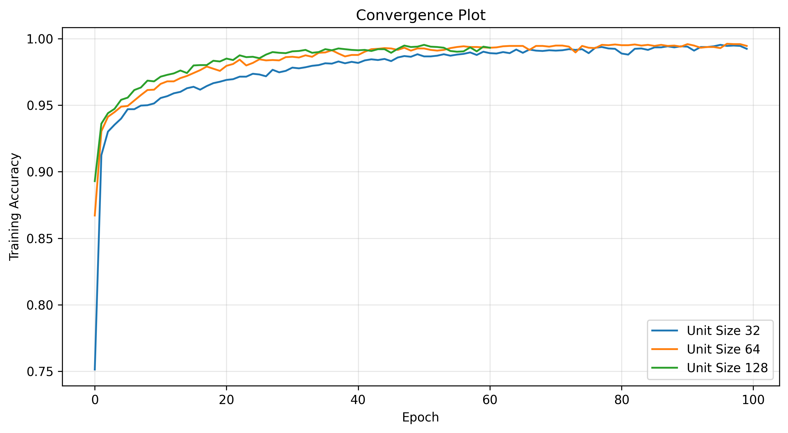
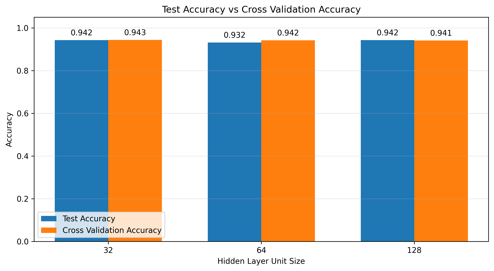
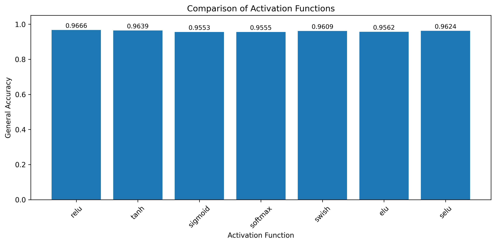

# Spam Email Classification using MLP

A Python-based binary classification project that identifies email spam using a Multilayer Perceptron (MLP) architecture on the UCI Spambase dataset.

## Repository Contents
* `py.py`: Main script for dataset loading, preprocessing, model training, cross-validation, and plotting.
* `figure1_convergence.png`: Accuracy convergence over 100 epochs for hidden layer sizes of 32, 64, and 128.
* `figure2_comparison.png`: Comparison between test set accuracy and 5-fold cross-validation accuracy.
* `figure3_activations.png`: Benchmark of overall accuracy across different activation functions.

## Implementation & Parameters
* **Dataset**: UCI Spambase (4,601 samples, 57 features).
* **Preprocessing**: Standardized features using `StandardScaler` with an 80/20 train-test split.
* **Model**: Sequential MLP with two hidden layers and a Sigmoid output layer.
* **Training**: Adam optimizer, binary cross-entropy loss, 100 epochs, batch size 32.

## Experimental Results

### 1. Convergence Rates
Training progress across 100 iterations for unit sizes 32, 64, and 128:


---

### 2. Generalization Performance
Test accuracy versus 5-fold cross-validation accuracy across hidden unit sizes:


---

### 3. Activation Functions Comparison
Overall accuracy benchmark across activation functions (`relu`, `tanh`, `sigmoid`, `softmax`, `swish`, `elu`, `selu`):


## Requirements & Usage

### Setup
Install dependencies:
```bash
pip install numpy pandas scikit-learn tensorflow matplotlib keras
